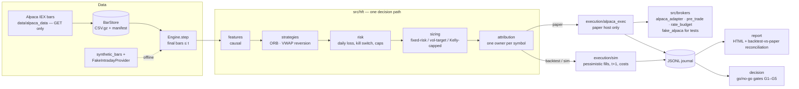

# HFT-V1 — Intraday Systematic Trading Engine + Daily Portfolio Optimizer

An event-driven intraday trading engine on 1-minute bars, plus a daily portfolio-construction stack. One decision path serves backtest, simulation and an Alpaca **paper** account. Both parts run offline on synthetic data.

> **SHOWCASE VERSION** — This public repository is a sanitized demonstration of a private project. Proprietary logic, parameters, and licensed data have been removed or replaced with synthetic data. The full private repository can be reviewed on request: read-only collaborator access can be granted during an interview.

> **About the name.** Despite "HFT" in the project name, this is **not** high-frequency trading. It trades 1–5 minute bars, is flat by the close, uses no L2/L3 order book, and has no sub-second latency edge. It is a rule-based, intraday, research-grade engine with a strict no-look-ahead discipline.

---

## Problem and motivation

Intraday strategy research usually fails at the seams:

- the backtest fills differently from the broker;
- strategies peek at bars that were not final yet;
- costs are modelled twice, differently;
- positions from different strategies collide.

This project makes those seams explicit:

- **One engine** (`src.hft.engine.Engine.step`) is called by backtest, simulation and paper. Only the bar provider and the execution adapter change.
- **Causality.** A decision on bar `t` uses only bars that are final at `t` and executes at `t+1` at the earliest. A bar starting at `T` is usable from `T + timeframe + grace`.
- **One cost model** (`src/hft/costs.py`), one risk layer and one owner per position (`src/hft/attribution.py`).
- **Theory before code.** Every strategy carries a `TheoryCard` (hypothesis, mechanism, references, parameters with justification and source, kill criteria). The registry refuses a strategy whose parameters do not match its card.
- **Go/no-go protocol** (`src/hft/decision.py`). Gates on expectancy, t-stat, Deflated Sharpe Ratio, PBO, out-of-sample trade count, P&L concentration and paper-vs-model slippage decide whether a strategy may be promoted. The module never promotes anything by itself.

## Architecture



The **daily portfolio stack** (frozen legacy component) runs: universe filter (liquidity / Amihud) → rolling expected returns and covariance estimators → optimizer registry (mean-variance SOCP, robust Charnes–Cooper, transaction-cost aware, HRP) → signal stack and regime → rebalancing engine with turnover and group caps → rolling out-of-sample backtest → metrics, an HTML dashboard and a monthly report.

## Tech stack

- **Language and tooling:** Python 3.11–3.12, pandas 3, NumPy, websockets. The research extras are cvxpy, SciPy, scikit-learn, Plotly and yfinance.
- **Broker client:** raw `urllib` + websockets against the Alpaca paper API, with no SDK. It is hard-locked to the paper host and checks the account id.
- **Quality:** pytest (about 1,600 offline tests), ruff, hash-locked requirements (`uv pip compile --generate-hashes`), a Dockerfile that runs the suite as a non-root user, and GitHub Actions CI on a 3.11/3.12 matrix.

## Key features

- **Strict config.** `config/hft.toml` is loaded into a frozen `HftConfig` in which every key is required, and the config hash travels with every run.
- **Bar store.** Monthly CSV.gz partitions per symbol, timeframe and feed, with a manifest and data-quality checks.
- **Pessimistic simulator:**
  - spread, impact and fee model;
  - partial fills;
  - marketable-limit semantics;
  - passive limits fill only when price crosses by at least one tick.
- **Risk:** daily loss limit, kill switch (env var or file), per-symbol and leverage caps, entry cut-off before the close, and a forced flatten.
- **Statistical validation:** Deflated Sharpe Ratio, Probability of Backtest Overfitting, and an append-only trial log for honest multiple-testing accounting (disabled in the demo).
- **Paper execution:**
  - idempotent client order ids;
  - order-update stream;
  - shared API rate budget;
  - pre-trade guards;
  - a loopback fake exchange (`src/brokers/fake_alpaca.py`) so the paper path is integration-tested without network.
- **Portfolio stack:** pluggable optimizers behind one typed interface (`OPTIMIZERS` registry with declared requirements and fallbacks), and rolling OOS backtests with failure logging.

### Experimental modules

Not wired into any execution path (enforced by `tests/test_repo_config.py`):

- `src/risk_profiles.py` — presets per risk profile.
- `src/tail_risk_overlay.py` — tail-risk overlay interface (blocked on implied-volatility data).

## Run the demo (synthetic data, offline)

```bash
python3.12 -m venv .venv
.venv/bin/pip install --require-hashes -r requirements.txt   # or requirements-core.txt for the engine only

make demo          # intraday engine on synthetic 1-minute bars (~1 min)
make integration   # portfolio stack: results/dashboard.html + results/report.html on synthetic data
make test          # offline test suite
make lint
```

`make demo` runs `scripts/demo_synthetic.py`. It builds a fake session calendar, generates seeded 1-minute bars for every configured symbol (random walk with mild mean reversion and rare jumps, from `src/hft/data/synthetic.py`) and runs the real backtest engine. Nothing is written to the repository. **The P&L it prints is meaningless as a performance claim.**

The portfolio demos use the synthetic panel in `src/demo_data.py`.

## Screenshots

> Placeholders. No images are included yet.

| # | What to capture | Suggested file |
|---|---|---|
| 1 | `make demo` console summary (header "SYNTHETIC intraday backtest") | `docs/img/demo.png` |
| 2 | `results/dashboard.html` from `make integration` | `docs/img/dashboard.png` |
| 3 | `results/report.html` monthly report | `docs/img/report.png` |
| 4 | `make test` summary line | `docs/img/tests.png` |

## Project structure

```
hft-v1/
├── config/hft.toml           # intraday config (strict; every key required)
├── config/live.toml          # daily portfolio runner config
├── universe*.csv             # instrument master and universes (public tickers)
├── src/
│   ├── hft/                  # intraday: engine, session, backtest, costs, risk, sizing, book,
│   │   │                     # attribution, calendar, features, validation, decision, report
│   │   ├── data/             # alpaca_data (GET only), bar_store, download, quality, synthetic
│   │   ├── execution/        # sim (pessimistic), alpaca_exec (paper)
│   │   └── strategies/       # orb, vwap_reversion (reference) + 4 interface stubs
│   ├── brokers/              # paper-only Alpaca adapter, stream, pre-trade, rate budget, fake exchange
│   └── *.py                  # daily portfolio stack: data, estimators, optimizers, rebalancing,
│                             # backtest, metrics, dashboard, monthly report, ledger, notifier
├── scripts/                  # run_intraday.py (signals | sim | paper), demo_synthetic.py,
│                             # run_periodic_rebalance.py, paper daily runner, capacity tools
├── experiments/              # portfolio experiments (download public prices when run)
├── research/probe_tickers.py # data-quality probe for candidate tickers
├── tests/                    # offline suite (synthetic data, fakes, no network)
├── Dockerfile, Makefile, pyproject.toml, requirements*.in/.txt
```

## Limitations

- **Strategy coverage.** Only two of the six intraday strategies are published as working reference implementations:
  - ORB, after Zarattini et al.;
  - VWAP reversion.

  Intraday momentum, pairs on an OU spread, hourly momentum and Avellaneda–Stoikov market making are **interface stubs** that never trade.
- **Synthetic bars** have no intraday seasonality, auction prints or realistic volume profile. Strategy behaviour on them says nothing about real markets.
- **Feed and execution.** IEX bars are a fraction of consolidated volume, and the paper venue does not simulate queue priority. Both are documented assumptions of the engine.
- **The daily portfolio runner is frozen.** Experiments download public prices when run and are not part of the offline demo.

## Roadmap

- Publish anonymised walk-forward reports produced by the go/no-go protocol.
- Intraday seasonality and volume curves in the synthetic generator.
- Order-book-aware simulator mode (L2 replay) for passive-limit research.
- Typed CLI around `scripts/run_intraday.py`, with structured logging.

## What this showcase omits and why

| Omitted / changed | Why |
|---|---|
| Internals of 4 strategies (intraday momentum, pairs OU, hourly momentum, Avellaneda–Stoikov) and their tests | Strategy logic and research notes are proprietary. They are replaced by interface stubs that keep the engine, registry and session wiring intact. |
| Private pair list | Replaced by one illustrative textbook pair (the config loader requires at least one). |
| Signal-stack factor weights | Replaced with equal-weight placeholders. |
| Market data (`data/`), backtest results, trial log, live state and journals | Alpaca/Yahoo data has redistribution limits, and results and positions are private. |
| Yahoo-derived research CSVs, universe-selection notes, technical report, notebook, internal planning and AI-prompt documents, architecture/roadmap docs | Third-party-derived data or internal documents. |
| Broker account ids, author/affiliation details, self-hosted CI runner | Personal or infrastructure details. Account ids are placeholders, and CI targets GitHub-hosted runners. |
| Tests tied to omitted files or to stubbed strategies | They cannot run against the showcase. All remaining tests run offline. |
| Git history | Fresh history for the showcase. |

Most code comments and docstrings are in Spanish, the project's working language.

## License

All rights reserved. See [LICENSE](LICENSE).
